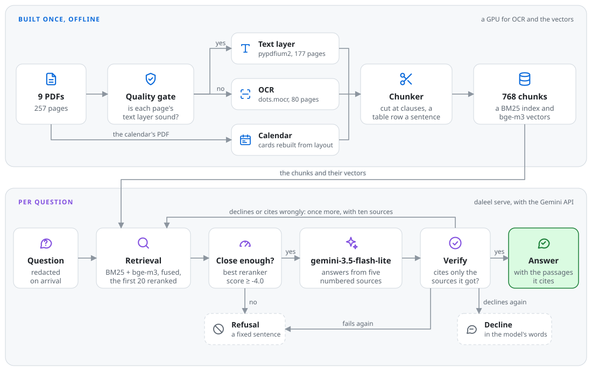

# Daleel · دليل

[](https://github.com/BATMANK1/daleel/actions/workflows/ci.yml)

Answers students' questions about the regulations of the Royal Commission for
Jubail and Yanbu's colleges, in Arabic or English, and cites the document,
page and clause behind every answer.

On 20 held-out questions, answered once with the pipeline frozen, a judge
model checked against hand labels marks 13 of Daleel's answers correct and 6
partial: an accuracy of 0.65, with a 95% interval of 0.45 to 0.85, and one
hallucinated answer. Given the whole corpus in its context instead, the same
answering model scores the same, at about 44 times the cost per question;
given no documents, it scores 0.10. Retrieval puts 91% of the evidence those questions
need among the five passages the model reads, where a naive pipeline
(poppler's `pdftotext`, BM25 on words as written) puts 11%. See
[Results](#results).

> **Status: phase 1 complete.** Extraction, retrieval, answering and the web
> service are built and measured, once, on the held-out questions. Phase 2,
> which fine-tunes a small open model to compare with retrieval, has not
> started. Daleel is a research aid, not an official source.

## The problem

Students need answers from 257 pages of Arabic regulation documents:
*Can I transfer majors? What GPA do I need? When is the drop/add deadline?*
Today the options are reading all of it, asking a classmate who may be wrong,
or waiting for the registrar.

An unsourced answer about your own academic standing is unusable: you cannot
act on it and the registrar cannot confirm it. So **every answer this system
gives carries a document, page and clause reference.** Citation is a hard
functional requirement, not a feature.

The documents make this harder than it looks. Read with pdfplumber or
poppler's `pdftotext`, six of the nine give most of their Arabic as
presentation forms, glyph variants that share no codepoints with what a
student types. The three exported from Word and PowerPoint give valid Arabic
letters that spell the wrong words, which no structural check can flag. And
25 of the 257 pages have no Arabic text layer at all. A pipeline that trusts
the text layer answers from text that is not on the page.
[How it works](#how-it-works) shows each failure and what Daleel does about it.

## Architecture

<picture>
  <source media="(prefers-color-scheme: dark)" srcset="docs/architecture-dark.svg">
  
</picture>

The first part runs once, offline, and needs a GPU for OCR and for the
vectors. The second runs for every question, on any machine, faster with a
GPU: it reads the chunks and their vectors, and calls Google's Gemini API for
each answer. A refusal is a fixed sentence; a decline is the model's own, and
may name what the documents leave out. [How it works](#how-it-works) gives
every step and the evidence for it.

## Quickstart

Daleel answers from chunks of the colleges' documents, and the documents are
not redistributed here ([Source documents](#source-documents)). So it needs
two files made from the PDFs by the pipeline, `data/processed/chunks.jsonl`
and `data/interim/dense/bge-m3.npz`, and a Gemini API key, which
[Google AI Studio](https://aistudio.google.com/apikey) gives for free.

**With those two files**, copied from a machine that ran the pipeline,
Docker is all it takes:

```bash
git clone https://github.com/BATMANK1/daleel && cd daleel
cp .env.example .env                       # then set GEMINI_API_KEY in it
mkdir -p data/serve                        # for the query log and the stored replies
docker compose --profile gpu up --build    # with an NVIDIA GPU and its container toolkit
docker compose --profile cpu up --build    # or on any machine, with slower answers
```

Then open <http://127.0.0.1:8000>. The first start downloads bge-m3 and the
reranker, 6.9 GB, into the volume `models`, and later starts reuse them. The
GPU image takes 9.7 GB of disk. The data is mounted read-only, the key is
passed in when the container starts, and the service listens on this machine
alone ([`compose.yaml`](compose.yaml)). The service runs as user 1000, the
first user on most Linux machines, so `data/serve` must be writable by that
user.

**From the PDFs**, the pipeline needs Python 3.12, the nine PDFs placed as
[`data/README.md`](data/README.md) says, and an NVIDIA GPU for OCR and the
vectors:

```bash
uv venv --python 3.12 && source .venv/bin/activate
uv pip install -e ".[dense]"                          # on a GPU, PyTorch for your CUDA first
python3 scripts/fetch_lexicon.py                      # the quality gate's word list
sha256sum -c data/SHA256SUMS                          # your PDFs, checked against these
daleel extract data/raw/ --quantization fp8 --max-pixels 5400000
daleel chunk                                          # data/processed/chunks.jsonl
python3 scripts/encode_dense.py --encoders bge-m3     # data/interim/dense/bge-m3.npz
daleel serve                                          # or Docker, as above
```

`daleel extract` reads the pages its text layer cannot serve with dots.mocr,
served by vLLM as [`eval/results/ocr.md`](eval/results/ocr.md) shows. On an
RTX 3060 Ti it read the 80 such pages in 48 minutes. `daleel serve` reads
`GEMINI_API_KEY` from the environment or from `.env`.

**For invited users**, as in the pilot, the service stays on this machine and
[Tailscale Funnel](https://tailscale.com/kb/1223/funnel) gives it a public
HTTPS address, with TLS ending here. Only requests that send the access code
are answered. The invitation link carries it after `#`, a part of the address
the browser never sends to a server, and the page keeps it on the device:

```bash
python3 -c 'import secrets; print(secrets.token_urlsafe(12))'   # set it in .env as DALEEL_ACCESS_CODE
docker compose -f compose.yaml -f compose.pilot.yaml --profile gpu up --build -d
curl -fsSL https://tailscale.com/install.sh | sh                # once
sudo tailscale up --hostname daleel                              # once: log in at the link it prints
sudo tailscale funnel --bg 8000                                  # prints https://daleel.<tailnet>.ts.net
```

The invitation is `https://daleel.<tailnet>.ts.net/#code=<the code>`, and
`sudo tailscale funnel reset` closes the address again. `compose.pilot.yaml`
will not start the service without a code. The questions still go to the
Gemini API's free tier ([Limitations](#limitations)).

## Results

Every design choice was made on 60 development questions. The 20 held-out
questions were run once, at the tag `frozen-v1`, after the pipeline was
frozen, and they give the reported numbers wherever a table has them.

| Table | What it measures | Result | Details |
|---|---|---|---|
| T1 | How each document's text layer is damaged | Read with pdfplumber, six of the nine give 71% to 77% of their Arabic as presentation forms; the Word and PowerPoint exports give wrong letters; 25 of 257 pages have no Arabic text layer | [below](#why-this-is-not-a-chat-with-your-pdf-project) |
| T2 | OCR engines on hand-transcribed pages | dots.mocr misreads 4.4% of characters, against 11.7% to 14.4% for Tesseract and PaddleOCR | [ocr.md](eval/results/ocr.md#t2) |
| T3 | What extraction and each analyzer step buy BM25 | 78% of the held-out questions' evidence in the first five results, against 11% for a naive pipeline (dev: 84% against 15%) | [retrieval.md](eval/results/retrieval.md#t3) |
| T4 | Dense encoders, fusion and reranking | BM25 and bge-m3, fused and reranked: 91% of the held-out evidence in the first five (dev: 93%), in 238 ms per question at the median on an RTX 3060 Ti | [retrieval.md](eval/results/retrieval.md#t4) |
| T5 | Answer quality, by arm | The flow is correct on 0.65 of the held-out questions; arms B, C and the flow are not told apart | [held_out.md](eval/results/held_out.md#t5-quality) |
| T6 | Behaviour: fluency, citation format, refusals, structure | Not yet measured: it compares the fine-tuned arms of phase 2 | |
| T7 | Time and cost | Arm B costs $42.26 per 1,000 questions at paid rates, the flow $0.95 | [held_out.md](eval/results/held_out.md#t7-time-and-cost) |
| T8 | Answer quality by question type | Questions in several parts are the hardest: the flow is correct on 1 of 3 held out, and 2 of 7 on dev | [held_out.md](eval/results/held_out.md#t8-correct-answers-by-question-type) |
| T9 | The judge against hand labels | Same label on 56 of 60 answers, kappa 0.90 (0.78 to 0.98) | [judge_agreement.md](eval/judge_agreement.md) |

The answers (T5), on the held-out questions. Every arm uses
`gemini-3.5-flash-lite`, and the judge, `gemma-4-31b-it`, labels each answer
correct, partial, incorrect or hallucinated:

| Arm | What the model is given | Accuracy | 95% interval | Correct or partial | Hallucinated | $ per 1,000 questions |
|---|---|---|---|---|---|---|
| A | the question alone | 0.10 | 0.00 to 0.25 | 3/20 | 5/20 | 0.13 |
| B | all 768 chunks, about 140,000 tokens | 0.65 | 0.45 to 0.85 | 18/20 | 2/20 | 42.26 |
| C | the first five chunks retrieved | 0.70 | 0.50 to 0.90 | 19/20 | 1/20 | 0.79 |
| **flow** | **as C, then checked and asked again once** | **0.65** | **0.45 to 0.85** | **19/20** | **1/20** | **0.95** |

Twenty questions cannot tell arms B, C and the flow apart: the interval of
the difference between any two of them includes no difference. The 0.05
between arm C and the flow is one question on which the two answers differ
by two words and the judge labels them differently. So the flow is chosen
over arm B for its cost, about a 44th of arm B's, and its speed, and over
arm C for what it guarantees: every answer it returns, other than a decline, cites a source
it was given, and a question that retrieval finds nothing close to is
refused before the model sees it. On dev, where the prompt and the flow's
rules were set, the flow scores 0.77 and arm B 0.83
([answers.md](eval/results/answers.md)).

## Prediction

Stated on 9 October 2026, before any arm that answers questions was run.

The study compares five ways of answering: A, a model without the
documents; B, the whole corpus in the model's context; C, this pipeline,
retrieving clauses for the model to answer from; D, a model fine-tuned on
the corpus, without retrieval; E, the fine-tuned model with retrieval. Each
comparison holds the model fixed. Arms A to C use `gemini-3.5-flash-lite`
through Google's API, and arms A, C, D and E then run on one small
open-weight model, which unlike an API model can be fine-tuned.

1. **Arm A answers almost nothing.** Without the documents the model may
   know the general shape of Saudi college rules, but not these colleges'
   numbers. It will get few numeric questions exactly right, and it will
   state wrong values rather than say it does not know.
2. **Arm B comes close to arm C on accuracy, but not on citations or cost.**
   With the whole corpus in its context it can find most answers, within
   about 10 points of arm C's accuracy. But it has to name the page itself,
   so fewer of its citations will hold the answer, and each question will
   cost it about 50 times arm C's input tokens.
3. **Arm C leads on valid citations and exact numbers,** and declines the
   questions the corpus does not answer.
4. **Retrieval beats fine-tuning on knowledge.** Fine-tuning teaches form
   and behaviour far better than it teaches specific numbers. For a corpus
   of precise thresholds, such as a cumulative average of 3.75 out of 4.00,
   or fees of 250, 750 and 1,100 per credit unit, arm D will answer fluently
   and with wrong values. Arm E may beat arm C on behaviour (register,
   structure, declining what it cannot answer) while matching it on
   knowledge: retrieval for facts, fine-tuning for form.

With 72 answerable questions, differences under about 10 points are not
findings. Each prediction will be marked here as held or not held, with its
numbers, once its arms have run.

### How it held

Marked on 14 October 2026, from the held-out run, with dev beside it. With
20 held-out questions, 18 of them answerable, these comparisons are rougher
than the 72 questions the prediction had in mind.

1. **Mostly held.** Arm A scores 0.10 held out and 0.15 on dev, and states
   the gold number in 1 of the 6 held-out answers that need one (1 of 16 on
   dev). But the last part did not hold: it declines rather than guess, on 14
   of the 20 held-out questions and 41 of the 60 on dev. When it does answer,
   5 of its 6 held-out answers are hallucinated.
2. **Held in part.** Arm B is within 10 points of arm C: 0.65 against 0.70
   held out, and 0.83 against 0.75 on dev, where it is ahead. It costs more
   than predicted: 84 times arm C's input tokens held out (92 on dev), and 53
   times its cost in dollars. Its citations are worse on dev only: 0.73 of
   the chunks it cites hold the answer, against arm C's 0.81. Held out, the
   two tie, at 0.78 and 0.77.
3. **Not held as stated.** Held out, arm C leads arm B on neither measure:
   both state the gold number in 6 of 6 answers, and their citation
   precision is 0.77 and 0.78. On dev, arm C led on citations, 0.81 against
   0.73, and tied on numbers, 16 of 16 each. It declined every question the
   corpus cannot answer: the two on dev, and the one held out.
4. **Not yet tested.** Arms D and E are phase 2.

## Limitations

- **Few questions.** The reported numbers rest on 20 held-out questions, so
  one question moves an arm's accuracy by 0.05, and each interval is about
  0.4 wide.
- **The judge.** It agrees with hand labels on 56 of 60 dev answers, but on
  the held-out run it gave different labels to two pairs of answers that say
  the same thing ([held_out.md](eval/results/held_out.md#limits)). Its rubric
  does not check the language of an answer.
- **English questions can get Arabic answers.** The prompt asks for the
  question's language, and the three English dev questions got English, but
  the held-out English question was answered in Arabic, and so was an
  English question about the week, asked of the running service.
- **Answers that stop short.** The flow's most common miss, held out, is an
  answer that gives part of what its sources say: a step, or a condition
  that comes with a number.
- **Retrieval.** Questions in several parts lose evidence that ranks below
  tenth, and a procedure that runs onto the next page can lose its last
  steps ([held_out.md](eval/results/held_out.md#where-the-flow-falls-short)).
- **The corpus.** Daleel knows the nine documents as published, and nothing
  newer. Its sense of time comes from the 1448 calendar alone: it counts a
  semester's weeks in sevens from the semester's first day, holiday weeks
  included, which may not be how a college numbers them, and a date outside
  that year gets no week.
- **Privacy.** Questions are redacted on arrival, but they go to Google's
  Gemini API, and on its free tier Google may use them to improve its
  products, and people may read them
  ([terms](https://ai.google.dev/gemini-api/terms)). The page says so. A
  wider use than an invited pilot needs a paid key.
- **One question at a time.** The models and the API client serve one
  request at a time, so questions asked together wait in turn.
- **Pinning.** The Gemini models are hosted and may change. The service
  downloads the current bge-m3 and reranker, and does not check that
  bge-m3 is the revision the stored vectors were made with.
- **Reproducing.** The documents, their OCR and the chunks are not
  redistributed, so the numbers can be rebuilt only from the same PDFs,
  which `data/SHA256SUMS` identifies.

## What comes next

1. **Phase 2:** fine-tune a small open model on the corpus, with a leakage
   check, and run arms D and E against arm C on the same model, with T6.
2. **Three changes the held-out run pointed to,** each to be tried on new
   questions: keep the first decline when both tries decline, add each
   source's neighbouring chunks, and ask again when an answer's language
   differs from the question's.
3. **A gold_v2,** with the mistakes found in gold_v1 corrected and new
   held-out questions.
4. **Attachments,** such as a student's own schedule, read by a local model,
   so that nothing personal leaves the machine.

## How it works

The sections below follow the documents from PDF to answer, with what each
step was measured to buy. Numbers are on the development questions unless
they say otherwise.

### Why this is not a "chat with your PDF" project

Measuring the corpus before building anything turned up extraction damage that
no naive pipeline would notice. `daleel inventory data/raw/` reports it, and
`--backend pdfplumber` gives the first presentation-form column:

| Document | Producer | Pages | Chars per page | Presentation forms, pdfplumber | Presentation forms, pypdfium2 |
|---|---|---|---|---|---|
| Student Guide 2025 | PDFium | 86 | 1,297 | 77% | 0% |
| Academic weeks 1448 | Adobe PDF library 18.00 | 3 | 1,637 | 71% | 0% |
| Guidance manual | Microsoft® Word 2019 | 19 | 566 | 0% | 0% |
| Library services | Microsoft® PowerPoint® 2019 | 16 | 320 | 0% | 0% |
| Orientation 1446 | Microsoft® Word 2019 | 13 | 202 | 0% | 0% |
| Organizational regulations | none | 58 | 1,445 | 76% | 0% |
| Code of student conduct | Adobe PDF library 15.00 | 12 | 1,665 | 75% | 0% |
| Student charter | Adobe PDF library 15.00 | 8 | 900 | 76% | 0% |
| Student portal guide | GPL Ghostscript 10.00.0 | 42 | 387 | 77% | 0% |

Five failure modes sit behind those numbers:

1. **Presentation-form substitution.** In six of the nine documents, most
   Arabic extracts as Unicode Arabic Presentation Forms, the contextual glyph
   variants a renderer picks per letter position, rather than as base letters,
   at least through pdfplumber and pdftotext (see below). A student typing
   `نظام` cannot match an index holding `ﻧﻈﺎم`: different codepoints, so zero
   term overlap.
2. **Silently wrong text.** The Word and PowerPoint exports report 0%
   presentation forms and look clean by every structural measure, but the text
   is wrong: `رؤيتنا` ("our vision") extracts as `وؤيتنا`, with letters
   substituted and dropped. These are valid Arabic codepoints that are not
   real words, so nothing structural can flag them. Verified by rasterising
   pages and reading them against the text layer.
3. **Low text density.** The PowerPoint and orientation documents yield about
   200 to 320 characters per page, meaning most of their content is graphics
   and needs OCR regardless of whether the extracted text is sound.
4. **Text drawn as shapes.** Design tools can convert text to vector outlines,
   leaving no text layer at all. 25 of the 257 pages have no Arabic in their
   text layer, from covers to the regulations' page defining every grade code,
   and only OCR can read them.
5. **Glyph codes read as characters.** One page embeds a form whose fonts carry
   no usable character map, so its text layer holds Ethiopic and Canadian
   Syllabics letters instead of Arabic.

#### The failure signature depends on the extraction backend

The first five documents, read with pdfplumber and with poppler's `pdftotext`:

| Document | pdfplumber chars | pdftotext chars | Presentation forms | pdftotext bidi controls /1k |
|---|---|---|---|---|
| Student Guide 2025 | 109,280 | 120,157 | 77% | 93.5 |
| Academic weeks 1448 | 4,811 | 5,776 | 71% | 156.5 |
| Guidance manual | 10,629 | 12,976 | 0% | 126.1 |
| Library services | 4,924 | 5,624 | 0% | 121.3 |
| Orientation 1446 | 2,595 | 3,089 | 0% | 139.9 |

The presentation-form ratio agrees between these two, but a third extractor,
pypdfium2, returns base letters for the same glyphs, so the ratio describes how
an extractor maps glyphs rather than the PDF alone. Word order differs too:
pdfplumber writes Arabic in visual order, spelling every word backwards, which
is why the pipeline extracts text with pypdfium2
([calibration](eval/results/gate_calibration.md)).

`pdftotext` also writes a form feed after every page. Once those and its bidi
marks are subtracted, the two backends agree on text length within 2% on four
documents and 6.5% on the guidance manual. Quality gate thresholds are
therefore only meaningful per backend, and must be recorded with one.

Scaled pages break pdfplumber's word grouping. The regulations, the conduct
code and the charter define their pages at one tenth of A4, and pdfplumber
groups characters into lines and words with fixed tolerances sized for standard
pages. On these it merges lines and splits words: page 4 of the regulations
gives 1,690 words through pdfplumber and 359 through pypdfium2, from the same
1,846 letters. With its tolerances scaled to the page, pdfplumber gives 360.
`scripts/inspect_pages.py` shows this for any page.

#### Provenance

The 1448 academic calendar first added to the corpus turned out, on reading its
footer, to be an unofficial student redesign that states it does not represent
the Royal Commission. It was replaced with the official calendar. The
unofficial file was also the only source of real control-character corruption
seen so far, and of a large unexplained disagreement in character counts
between the two backends. Both left the corpus with it.

A second derivative turned up later: an AI-generated `.ics` version of the
full-year calendar, identified by its metadata. All 37 of its dates match the
official calendar, but it rewrote one summer deadline from the end of drop and
add to the end of add, which would mislead a student. It is used only to
cross-check the calendar ground truth's dates, and is never cited.

The organizational regulations first arrived as a 70-page copy shared on
WhatsApp, with metadata that looked entirely official. Comparing it against the
college's site showed two documents bound together: the site publishes the
58-page regulations and the 12-page code of student conduct separately, and
both are in the corpus as published. A copy of the conduct code saved through a
browser's print dialog was likewise replaced with the original download. The
student guide, which the site does not offer for download, comes from the
Student Affairs department's Telegram channel, where the post has since been
removed.

Every document's SHA-256 is recorded in [`data/SHA256SUMS`](data/SHA256SUMS),
and `sha256sum -c data/SHA256SUMS` checks a local copy against it.

### Extraction routing

`daleel route data/raw/` predicts, for each document, which extraction path to
try first and which failure to expect, from the software recorded in its
metadata:

| Document | Producer | Path | Expected failure |
|---|---|---|---|
| Student Guide 2025 | PDFium | text layer | presentation forms |
| Academic weeks 1448 | Adobe PDF library 18.00 | text layer | presentation forms |
| Guidance manual | Microsoft® Word 2019 | OCR | lossy substitution |
| Library services | Microsoft® PowerPoint® 2019 | OCR | lossy substitution |
| Orientation 1446 | Microsoft® Word 2019 | OCR | lossy substitution |
| Organizational regulations | none | text layer | unknown (default) |
| Code of student conduct | Adobe PDF library 15.00 | text layer | presentation forms |
| Student charter | Adobe PDF library 15.00 | text layer | presentation forms |
| Student portal guide | GPL Ghostscript 10.00.0 | text layer | unknown (default) |

A route is a prior, not a verdict. The quality gate still checks every
document, so a wrong prediction costs time and never correctness.

The rules come from the first five documents, and each rule in the code names
the documents it rests on. All three Microsoft documents have since been checked
against hand-transcribed ground truth, and all three text layers are broken:
their words match the page at 5%, 50% and 33% precision. Every route held,
including the orientation guide's, which had been a prediction only. Software
with no evidence behind it, including other Microsoft and Adobe products,
falls to a default: try the text layer and let the gate decide.

The four documents added later tested the rules out of sample. The conduct code
and the charter use Adobe PDF library 15.00, a version no rule was built from,
and routed correctly. The regulations carry no metadata at all, and an online
compressor rewrote the portal guide's producer and creator, so both took the
default, and the gate then trusted their text layers.

### Quality gate

`daleel gate data/raw/` judges every page: can its text layer be trusted, or
must the page go to OCR? It extracts text with pypdfium2, normalizes it, and
checks its words against a web-scale Arabic word list, with thresholds
calibrated against the hand-transcribed ground truth.

| Document | Route | Pages | Trusted | Untrusted | No Arabic text | Agrees |
|---|---|---|---|---|---|---|
| Academic weeks 1448 | text layer | 3 | 3 | 0 | 0 | yes |
| Guidance manual | OCR | 19 | 1 | 18 | 0 | yes |
| Library services | OCR | 16 | 1 | 15 | 0 | yes |
| Orientation 1446 | OCR | 13 | 1 | 12 | 0 | yes |
| Student Guide 2025 | text layer | 86 | 82 | 2 | 2 | yes |
| Organizational regulations | text layer | 58 | 43 | 1 | 14 | yes |
| Code of student conduct | text layer | 12 | 9 | 0 | 3 | yes |
| Student charter | text layer | 8 | 3 | 0 | 5 | yes |
| Student portal guide | text layer | 42 | 37 | 4 | 1 | yes |

The router predicts each route from metadata alone; the gate reaches the same
conclusion for all nine documents by reading every word. Pages with no Arabic
in their text layer go to OCR whatever their document's route.

The gate still trusts two visibly broken pages, because their fragments are
real entries in a web word list, and it rejected two sound pages of the portal
guide over rare real words. Those limitations, the evidence behind every
threshold, and how to reproduce each number are in
[`eval/results/gate_calibration.md`](eval/results/gate_calibration.md).

### Extraction

`daleel extract data/raw/` turns every page into a record: its text, the
method that produced it, and the gate's evidence for the choice. A page keeps
its text layer when the gate trusts both the page and its document as a whole.
Every other page is read by OCR with dots.mocr, the most accurate engine in
[`eval/results/ocr.md`](eval/results/ocr.md), so the two broken pages the gate
still trusts are read by OCR too, since their documents go to OCR. An OCR record
also keeps the page's layout: each block's category, text and box, in the
page's own points, in reading order. dots.mocr reads parts of a page that sit
side by side left to right, so those are put right to left. It also writes two
Arabic spellings with letters of other scripts, the Thai ส for سب in أسبوع and
the Hebrew ת for ت, and those are repaired inside Arabic words. A page whose
OCR text holds less than half of the Arabic words in its text layer has lost
text, most often inside what its layout calls a picture, so it is read again
for its text alone, and what that reading adds goes in after the picture. How
the library deck's records were checked against its slides, and what that led
to, is in [`eval/results/layout.md`](eval/results/layout.md).

OCR needs dots.mocr served by vLLM, started as in
[`eval/results/ocr.md`](eval/results/ocr.md), and the same limits given to the
command:

```bash
daleel extract data/raw/ --quantization fp8 --max-pixels 5400000
```

Records go to `data/interim/extracted/<document>.jsonl`, a line per page.
Every OCR reading is kept in `data/interim/ocr_cache/`, keyed on the engine and
the page image, so a second run reads no page again, and an interrupted run
resumes where it stopped.

The whole corpus has been extracted. Of its 257 pages, 177 kept their text
layer, and dots.mocr read the other 80 in 48 minutes on the machine described
in [`eval/results/ocr.md`](eval/results/ocr.md): 22 seconds a page at the
median, and 139 seconds at most, for a page of the regulations drawn without a
text layer. Two library slides were read again for their text.

### Calendar

The academic calendar answers what students ask most often: when drop and add
closes, when exams start. The gate trusts its text layer, and PDFium reads
every event's lines whole, every date intact. What a page of text loses is the
grid: the event cards come in the order they were drawn, so a date can sit
beside another event's title. OCR is no way around it, since dots.mocr
invented a second date in every date box.

`daleel calendar` rebuilds each card from where its lines sit on the page.
Every card prints exactly one Gregorian date, so each date anchors a card, and
the lines in its column, from the title above it down to the Hijri date below
it, are that card's. Cards are read top to bottom and each row right to left,
as the annotation guidelines read a page. Two faults of the text layer are
mended: its English font writes the fi ligature as the control character
U+001F, and five times a word lost the space before it, as in `الدراسيالأول`.
A word the gate's word list does not hold, which splits exactly one way into
two words it does, is split.

```bash
daleel calendar data/raw/academic_weeks_1448.pdf
python3 scripts/check_calendar_csv.py data/interim/calendar/academic_weeks_1448_p01.csv <ics> 14
```

Each page's rows go to `data/interim/calendar/<document>_p<NN>.csv`, in the
ground truth's columns: the title, the days, each in Arabic and in English,
then the Gregorian and the Hijri date as printed.

Page 1 came out identical to its hand-transcribed ground truth, all 84 cells
of its 14 rows. Pages 2 and 3 have no ground truth, so the checks stand in for
it, and every row passes them: its Gregorian dates are an event's dates in the
.ics, its two calendars agree on how long the event lasts, and its English days
are the days its dates fall on. The three pages give 37 rows, and their dates
pair off one to one with the 37 events of the .ics, the AI-generated copy
described under [Provenance](#provenance), trusted for its dates and nothing
else.

The later pages' quirks stay as printed, as ground truth keeps them: page 2's
`Semestet`, page 3's `حذف و إضافة`, months and days of one digit, a space
before a date's suffix, and a Hijri range over two lines, each a full date
with its own suffix. The checks read all of these.

### Chunking

`daleel chunk` cuts the records into chunks along the documents' own
structure, since a chunk cut through the middle of a clause cites nothing. A
heading is a title or section header in an OCR page's layout, an article's
label, a numbered part such as `ثانياً:`, or one of the sections the student
guide's table of contents lists. A unit starts at a numbered clause (`.1`,
`1-`, `1)`), a bullet or a layout block. Running headers, page numbers and
pictures are left out. Units shorter than 40 words merge with their
neighbours under the same heading on the same page, and units longer than 180
are split at a sentence end, with 30 words of overlap. A chunk never spans two
pages, so it always cites a single page.

The regulations' text layer prints each article's label at the end of the
article's first line, because the margin holding the label is read with that
line. Those labels are taken as headings when they end in a colon or follow
the last article's number. A passing reference such as `في المادة الخامسة` is
not taken as a heading. This finds 71 of the regulations' 72 articles and all
37 of the conduct code's. The one it misses, article 1, has no label in the
extracted text.

A table becomes one sentence per row, with each value named by its column, so
a retrieved row can be cited on its own: `الفئة: الطلبة، عدد الكتب: 5 كتب، مدة
الاعارة: 14 يوم`. Tables come from three places. An OCR page's layout gives
its tables as HTML, and a merged cell is repeated in every row it covers. The
academic calendar's 37 cards become a chunk each, rebuilt as
[Calendar](#calendar) describes and named with their semester, so `daleel
chunk` reads the calendar's PDF as well as the records. And one table's text
layer lists its amounts apart from their rows: the fee table on page 28 of
the student guide. It was typed in by hand from the rendered page, and is in
[`data/manual/tables.json`](data/manual/tables.json) with the lines of the
text layer it replaces. Its chunk is marked `manually_verified`.

```bash
daleel chunk    # data/interim/extracted/ to data/processed/chunks.jsonl
```

The 257 pages give 768 chunks. Every chunk carries what a citation needs: the
document's title, scope and date, the chunk's page, heading and clause number,
whether it is a clause, prose or a table, and how its page was extracted, so a
wrong answer can be traced back to its page.

### Gold set

[`eval/gold_v1.jsonl`](eval/gold_v1.jsonl) holds the 80 questions that
retrieval and answers are measured on: 28 asked by classmates, one by the
author, 47 written to cover the corpus, and 4 English translations. They
come in eight types, from single clauses and numbers to questions the corpus
cannot answer. Each question names the pages that answer it and quotes the
words on them that hold the answer. Every answer was drafted from the
extracted text, then checked by hand against its PDF page. The review changed
six of them, and the set was frozen on 6 October 2026. A mistake found later
will go into a gold_v2, reported beside it.

Twenty questions are held out for the final comparison and not looked at
during development. They are chosen in whole topic groups, so no paraphrase
of a held-out question is among the other 60, and each type is held out in
its share of the set (`choose_final` in `daleel.eval.gold`, seed 1448). Of the
72 questions the corpus answers, 54 are for development and 18 are held out.

### Retrieval

The gold set names pages and quotes, not chunks, so the evidence a question
needs is found anew for every way of chunking: a chunk holds a quote when the
quote's words, normalized, appear in its text one after another, whatever the
punctuation and spacing between them, and a quote given as a group of parts
holds only where all of them are in one chunk. A question needs every quote
on every page that answers it. `scripts/eval_retrieval.py` searches the
chunks for each of the 72 questions the corpus answers and reports recall
and completeness at 1, 5, 10 and 20, and MRR@10, overall, by question type
and by language.

The first retriever is BM25 with Lucene's parameters over an Arabic
analyzer: normalization for comparison, stopwords (with the colloquial
question words of Saudi Arabic), and Lucene's light stemmer. Each step can
be turned off, to measure what it buys: `scripts/ablate_normalization.py`
adds them one at a time, and sets the pipeline's chunks beside a naive
pipeline's, poppler's `pdftotext` read word for word, chunked the same way
(table T3). On the 54 development questions:

| BM25 | recall@5 | complete@5 |
|---|---|---|
| pdftotext, words as written | 0.154 | 0.148 |
| pdftotext, full analyzer | 0.597 to 0.662 | 0.500 to 0.593 |
| pipeline, words as written | 0.569 | 0.519 |
| + normalization | 0.752 | 0.685 |
| + stopwords | 0.758 | 0.685 |
| + light stemming | 0.841 | 0.759 |

The pdftotext rows depend on the poppler version: 26.01 and 24.02 give the
two ends of each range. Its text lacks a quarter to a third of the
evidence, almost all of it on pages the quality gate sends to OCR.
Normalization is the largest single step, and stemming the next; stopwords
change nothing measurable. The 13 questions without all their evidence in
the first five ask for several clauses at once, word things as students do
rather than as the regulations do, name documents instead of the rule, or
ask in English.
[`eval/results/retrieval.md`](eval/results/retrieval.md) has the held-out
questions, every miss, and the limits.

Dense retrieval is measured the same way (table T4). Two multilingual
encoders, bge-m3 and multilingual-e5-large-instruct, map questions and chunks
to vectors; BM25 is fused with each and with both by reciprocal rank fusion;
and a cross-encoder, bge-reranker-v2-m3, reorders the first 20 of each
fusion. The models want a GPU that the evaluation need not have, so
`scripts/encode_dense.py` and `scripts/score_rerank_pool.py` compute the
vectors and scores once and keep them in `data/interim/`, each under a hash
of the text it came from, with the model, its revision, the library versions
and the device. `scripts/eval_hybrid.py` measures every row from those alone.
On the 54 development questions, with times per question on an RTX 3060 Ti:

| | recall@5 | complete@5 | p50 ms | p95 ms |
|---|---|---|---|---|
| BM25 | 0.841 | 0.759 | 0.6 | 1.0 |
| bge-m3 | 0.806 | 0.704 | 28.6 | 38.9 |
| BM25 + bge-m3, fused | 0.873 | 0.796 | 29.2 | 39.4 |
| **BM25 + bge-m3, fused and reranked** | **0.931** | **0.852** | **237.5** | **298.0** |

On these questions neither encoder alone beats BM25, but an encoder and
BM25 miss different questions, so fusing them gives the reranker more of the
evidence to reorder. The reranker makes most of the gain and most of the wait. The
last row was chosen on the development questions; on the 18 held out, run
once afterwards, it puts 91% of the evidence in the first five, against
BM25's 78%. Of the 4 English questions, BM25 finds evidence for 2, and the
last row for all 4.

### Answering

`daleel serve` answers each question with a LangGraph flow
([`src/daleel/answer/flow.py`](src/daleel/answer/flow.py)):

1. **Retrieve.** The question is searched as asked, with T4's chosen
   retrieval: BM25 and bge-m3, fused, and the first 20 reranked. Rewriting
   it into search queries first found less evidence on dev, so the flow does
   not rewrite ([rewrite.md](eval/results/rewrite.md)).
2. **Refuse early.** If the reranker's best score among the five sources is
   below -4.0, retrieval found nothing close to the question, and the flow
   refuses without asking the model. The line sits a logit below every dev
   question that should be answered ([refusal.md](eval/results/refusal.md)).
3. **Generate.** `gemini-3.5-flash-lite` gets the five sources, numbered,
   each with its document, date, scope, page, section and clause, and arm C's
   prompt: use only the sources; cite them by number after every rule,
   number, date or step; name exactly what the sources leave out; where
   documents disagree, give each and do not choose; copy numbers as printed;
   and answer in the question's language.
4. **Verify.** The answer must cite, and cite only sources it was given. If
   it does not, or it declines, the flow asks once more with ten sources.
   After that, a decline stands, and anything else is refused with a fixed
   sentence.

A question about today's date or the current week, such as "which week are
we in?", also gets a source computed from the academic calendar
([`src/daleel/answer/today.py`](src/daleel/answer/today.py)): today's date
in Riyadh, in Gregorian and Umm al-Qura dates, and every week of the 1448
semesters, counted from each semester's first day.

Four arms are compared on the same model: A, the question alone; B, the
whole corpus in the model's context; C, the flow's first request alone; and
the flow. The judge, `gemma-4-31b-it` with a rubric checked against hand
labels, reads each answer beside the reference answer and the evidence
quotes. The dev runs are in [answers.md](eval/results/answers.md), the
held-out run in [held_out.md](eval/results/held_out.md), and the judge's
check in [judge_agreement.md](eval/judge_agreement.md).

### The service

`daleel serve`, or the Docker service, listens on port 8000, on this machine
alone unless told otherwise:

| Endpoint | What it gives |
|---|---|
| `GET /` | The page: a conversation in Arabic, right to left, whose cited passages open beside the answers |
| `POST /ask` with `{"question": "..."}` | The answer, as server-sent events |
| `POST /search` with `{"query": "...", "k": 5}` | The chunks retrieval ranks first, without asking the model |
| `GET /health` | `{"status": "ok", "chunks": 768}` |
| `GET /metrics` | Prometheus counts: questions by outcome, seconds per question, model tokens, searches |

With `DALEEL_ACCESS_CODE` set, `/ask`, `/search` and `/metrics` answer only a
request whose `X-Access-Code` header holds the code, and any other with 401.
The API's generated pages (`/docs`, `/openapi.json`) are not served.

`/ask` sends a `step` event as each step of the flow ends, then an `answer`
event, or an `error` event if the model cannot be reached:

```text
event: step
data: {"step": "retrieve"}

event: answer
data: {"answer": "... [1]", "outcome": "answered", "reason": "", "language": "ar", "sources": [{"n": 1, "chunk_id": "...", "doc_id": "...", "doc_title": "...", "page": 30, "section_heading": "...", "text": "..."}]}
```

The answer comes whole, not word by word, because it is not shown before its
citations are checked. `outcome` is `answered`, `declined` or `refused`, and
`sources` holds only the sources the answer cites, under the numbers it cites
them by.

Questions are redacted as they arrive: email addresses and long numbers,
such as student and phone numbers, become `[redacted]`
([`src/daleel/serve/privacy.py`](src/daleel/serve/privacy.py)). The query log,
`data/serve/queries.jsonl`, keeps each redacted question with its answer, its
sources and the hour, and nothing about who asked; no access log is written.
The page keeps a conversation in the browser tab alone, until the tab is
closed.

## Usage

```bash
uv venv --python 3.12 && source .venv/bin/activate
uv pip install -e ".[dev]"
python3 scripts/fetch_lexicon.py                  # the gate's word list: 69 MB, not committed
daleel inventory data/raw/                        # text-layer measurements, via pypdfium2
daleel inventory data/raw/ --backend pdfplumber   # the same, via pdfplumber, for comparison
daleel route data/raw/                            # predicted extraction path per document
daleel gate data/raw/                             # verdicts per document
daleel gate data/raw/ --pages                     # verdicts per page, with reasons
daleel extract data/raw/                          # every page's text as a record (OCR: see above)
daleel calendar data/raw/academic_weeks_1448.pdf  # the calendar's events, a row for each
daleel chunk                                      # the records cut into chunks, with their metadata
sha256sum -c data/SHA256SUMS                      # check your copies of the documents
python3 scripts/inspect_pages.py <pdf> <pages>    # what chosen pages are made of
python3 scripts/check_calendar_csv.py <csv> <ics> # check a page of calendar rows
python3 scripts/check_gold.py --records           # check the gold set, its quotes against the pages
python3 scripts/eval_retrieval.py --misses        # BM25 measured against the gold set's evidence
python3 scripts/ablate_normalization.py           # table T3: what extraction and each analyzer step buy
uv pip install -e ".[dense]"                      # the encoders and the reranker (see the dependency note)
python3 scripts/encode_dense.py                   # chunks and questions as vectors, kept for T4
python3 scripts/score_rerank_pool.py              # the reranker's scores for every candidate, kept for T4
python3 scripts/eval_hybrid.py                    # table T4: the encoders, fusion and reranking
python3 scripts/time_retrieval.py --dense bge-m3  # time each stage per question; --rerank adds the reranker
python3 scripts/ask_llm.py "سؤال"                 # one question to the answering model, stored for reruns
python3 scripts/run_arms.py --arms A C            # arms A and C on the dev questions, measured without a judge
python3 scripts/run_arms.py --arms B              # arm B: the whole corpus with every question
python3 scripts/draw_labels.py --runs <files>     # answers to label by hand, blind to the arm, for T9
python3 scripts/judge_agreement.py                # table T9: the judge against your hand labels
python3 scripts/judge_answers.py --runs <files>   # the judge's label for every answer of a run
python3 scripts/results.py --runs <judged files>  # tables T5, T7 and T8, with bootstrap intervals
python3 scripts/refusal_threshold.py              # where to refuse without asking the model, set on dev
python3 scripts/eval_rewrite.py                   # whether rewriting questions finds more evidence, on dev
daleel serve                                      # the page, and /ask, /search, /health and /metrics, on port 8000
docker compose --profile gpu up --build           # the same in Docker, from ./data (see compose.yaml); --profile cpu without a GPU
python3 scripts/ocr_eval.py tesseract             # score an OCR engine against the ground truth
python3 scripts/ocr_eval.py saved <run folder>    # score a saved OCR run again
pytest                                            # the test suite
```

Every `daleel` command but `serve` also accepts `--json`. `python3 scripts/calibrate_gate.py`
reproduces every number in the gate's calibration, given the hand-transcribed
ground truth, which is not redistributed.

## Dependency note

Text extraction uses **pypdfium2** (BSD-3-Clause or Apache-2.0), chosen by
measurement: pdfplumber writes Arabic in visual order, spelling every word
backwards (see [the calibration](eval/results/gate_calibration.md)). It is
held below 5.13, whose PDFium puts the words of an Arabic line last word first.
Each word is still spelled right, so nothing that counts words notices, and
every command reads a generated Arabic line first and stops on a build that
reorders it.
**pdfplumber** (MIT) remains as a comparison backend for the inventory. The
calendar's grid is rebuilt from PDFium's character boxes instead, which come
with its text in logical order.
PyMuPDF was ruled out because it is AGPL-licensed, a blanket disqualifier at
many organisations that would force this repository's own licence to match.

The `dense` extra pins **sentence-transformers** (Apache-2.0) and
**transformers** (Apache-2.0), so that vectors and scores from different runs
can be compared. It brings PyTorch with it: on a GPU, install the PyTorch
build for your CUDA version first, as <https://pytorch.org> shows, or pip may
bring one that does not use the GPU. The encoders are MIT-licensed and the
reranker Apache-2.0.

## Licence

MIT, see [LICENSE](LICENSE). The page's fonts, IBM Plex Sans Arabic and Noto Naskh
Arabic, are under the SIL Open Font License 1.1, with their licences in
[`src/daleel/serve/static/fonts/`](src/daleel/serve/static/fonts/).

## Source documents

The source documents are college publications and are not
redistributed here. See [`data/README.md`](data/README.md) for how to obtain
them.
